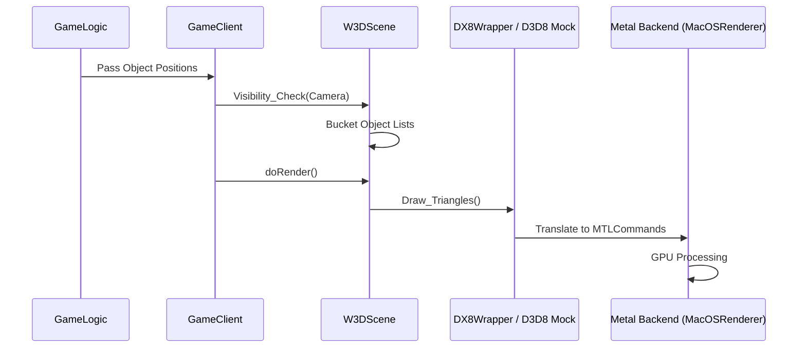

# Graphics Rendering Pipeline (macOS)

The rendering pipeline in the MacOS port bridges the original DirectX 8 based W3D engine with the modern Apple **Metal** API.

## High-Level Architecture

1.  **Scene Management**: `W3DScene` determines what is visible (Visibility Check) and buckets objects into render lists.
2.  **Display Layer**: `W3DDisplay` (and `W3DView`) coordinates the high-level rendering passes (Terrain, Shadows, Particles, Objects).
3.  **DX8 Compatibility Layer**: The engine still calls `DX8Wrapper` methods. On MacOS, these are mapped to platform-specific implementations that mimic D3D8 interfaces.
4.  **Metal Backend**: The `MetalDevice8` (implementing `IDirect3DDevice8`) performs the actual frame lifecycle management and draw calls using Metal command encoders.

## Platform Abstraction Strategy

- **D3D8 Headers**: Files like `d3d8.h` and `d3dx8math.h` in `Platform/MacOS/Include` provide the necessary types (`IDirect3DDevice8`, `IDirect3DVertexBuffer8`, etc.) needed for the engine to compile.
- **Binary Compatibility**: Buffers (`MacOSBuffers.h`) inherit from these mock interfaces to allow existing W3D code to interact with them as if they were native DX8 resources.

## Metal Rendering Flow

The main loop in `Win32GameEngine::update()` drives the frame:

1.  **BeginScene**: `MacOSRenderDevice` acquires a `CAMetalLayer` drawable and creates a `MTLCommandBuffer`.
2.  **Set State**: Modern shaders (Metal Shading Language in `MacOSShaders.metal`) are used to emulate fixed-function DX8 pipelines.
3.  **Draw Calls**: Commands like `Draw_Triangles` translate to Metal vertex/index buffer binds and `drawIndexedPrimitives` calls.
4.  **EndScene**: The command buffer is committed, and the frame is presented to the screen.

## Key Resource Types

- **Textures**: Loaded via `TARGA.h` or `ddsfile.h`, managed in a `TextureCache` within `MacOSRenderDevice`.
- **Shaders**: Default vertex and fragment functions handle common tasks like texturing and diffuse coloring.
- **Buffers**: Vertex and Index data is stored in `MTLBuffer` objects, optimized for GPU access.

## Implementation Files

- **Metal Backend**: `Platform/MacOS/Source/Metal/MetalDevice8.mm` and `MetalInterface8.mm`
- **Shaders**: `Platform/MacOS/Source/Main/MacOSShaders.metal`
- **Wrappers**: `Platform/MacOS/Source/Metal/MetalDevice8.h`
- **Buffer Mocking**: `Platform/MacOS/Include/MacOSBuffers.h`
